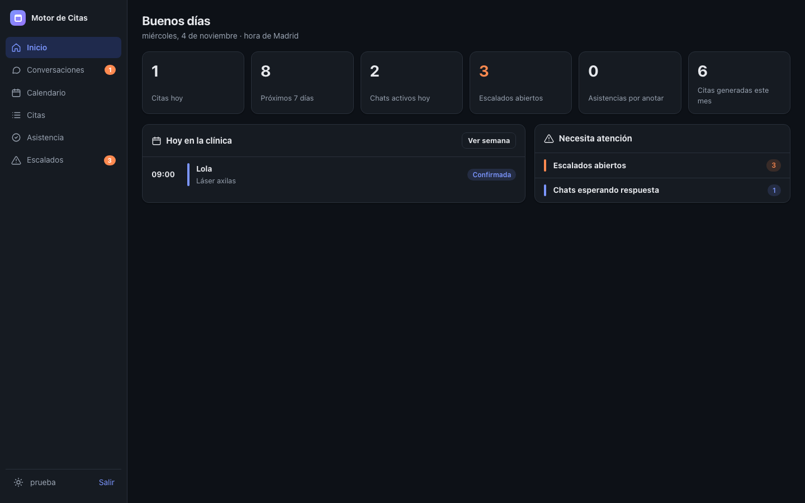
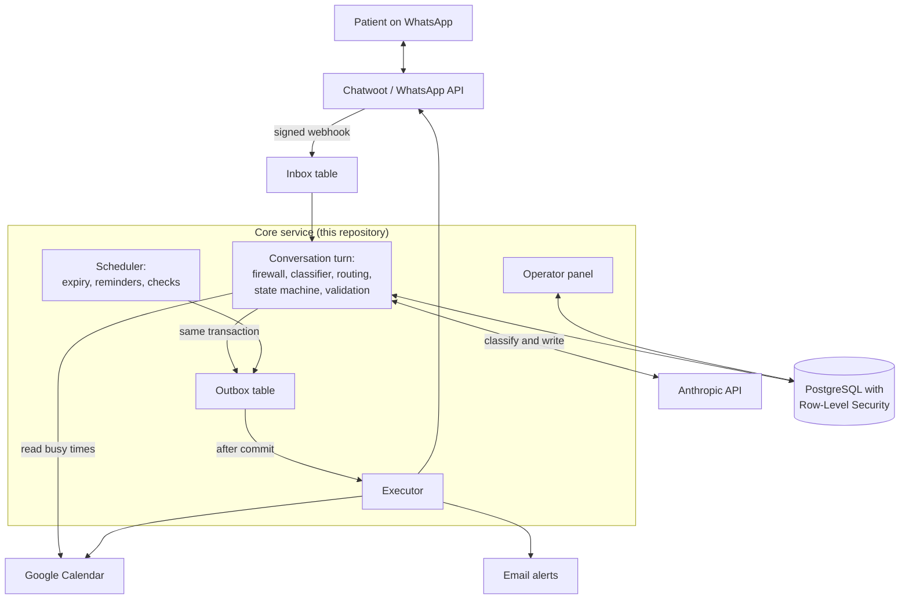
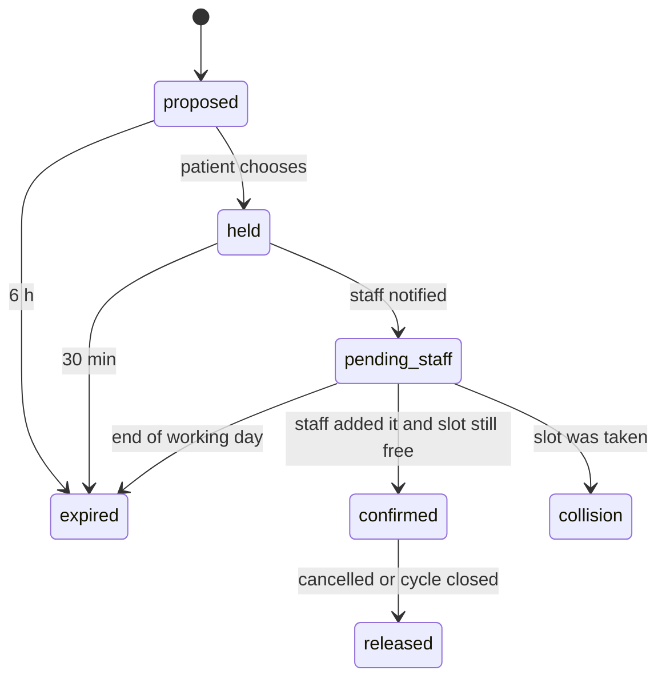
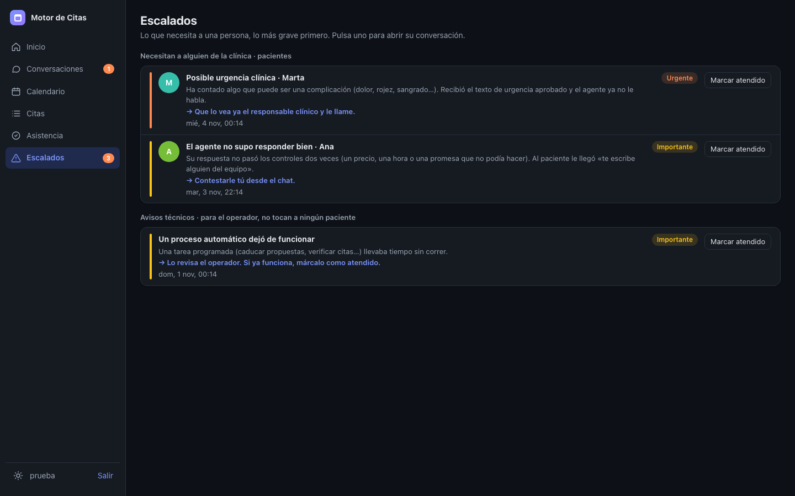
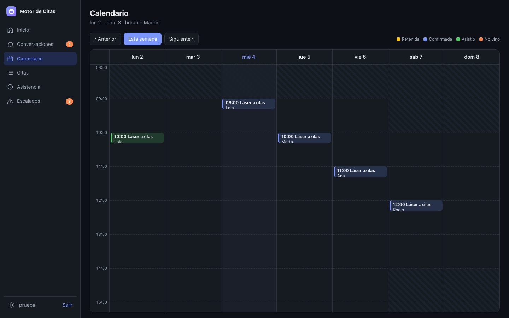

# AI Clinic Automation Engine

A WhatsApp assistant for private clinics that answers patients at any hour, offers real appointment times, and books them, with strict safety controls around the AI.



> This public version uses only fictional data. The operator panel and parts of the code use the internal name "Motor de Citas" (Spanish for "appointment engine"). Patient-facing text and most code comments are in Spanish because the product serves clinics in Spain. See the [glossary](docs/ARCHITECTURE.md#spanish-to-english-glossary).

## Project Overview

The system runs a clinic's WhatsApp conversations from first question to confirmed appointment. It answers questions about prices and opening hours, checks the clinic's calendar, offers three times, and asks a staff member to confirm when needed. It also sends reminders and passes sensitive messages to a person.

The core idea is simple: **the AI writes the messages, but ordinary, tested code makes the decisions.** The model cannot book an appointment, change a price, or give clinical advice.

## Business Problem

Clinics with recurring patients, such as aesthetic or laser clinics, lose bookings in a few predictable ways:

- Patients message at night or while reception is busy, then go elsewhere when nobody replies.
- Staff spend their time on repeated questions about prices and hours.
- A generic chatbot creates new risks. It can invent a price, promise a time that is not free, or respond casually to a possible medical complication.
- Clinics handle health data, so a leak between clients would be serious.

## Solution

Each patient message passes through a fixed pipeline. Safety rules that do not depend on AI run first. A small model then turns the message into structured data, and code chooses the action. A larger model writes the reply, and that reply is checked against the real system state before it can be sent.

If anything fails, such as the AI provider or the calendar, the patient still gets an honest message and a person is alerted when needed.

## Technologies Used

| Area | Tools |
|---|---|
| Language and runtime | TypeScript, Node.js 22+ |
| API and validation | Fastify, Zod |
| Database | PostgreSQL (Supabase in production), Drizzle ORM, Row-Level Security, `pg_cron` |
| AI | Anthropic API: `claude-haiku-4-5-20251001` to classify, `claude-opus-5` to write |
| Integrations | Chatwoot, WhatsApp Cloud API, Google Calendar API, SMTP email |
| Testing | Vitest, plus custom evaluation scripts for the AI behavior |
| Infrastructure | Docker |
| Earlier version | n8n ([retired workflows](legacy/n8n-workflows/) are included for reference) |

## System Architecture



A turn never writes to an outside system directly. It saves what should happen in an **outbox table**, in the same database transaction as the state change, and a separate process carries it out after the commit. If a turn rolls back, nothing is sent. If it commits, the action still happens even after a crash.

More detail is in [docs/ARCHITECTURE.md](docs/ARCHITECTURE.md), and the reasoning is in [docs/DESIGN_RULES.md](docs/DESIGN_RULES.md).

## Key Features

**For the clinic**

- Replies at any hour, while automated outbound messages stay within contact hours.
- Offers three real times, respecting the patient's preferences, opening hours, and service length.
- Handles rescheduling, cancellations, and patients with several appointments.
- Supports two booking modes: staff confirm each appointment, or the system creates the calendar event itself.
- Includes an operator panel for conversations, a weekly calendar, appointments, attendance, and escalations.
- Sends appointment reminders and tracks unsubscribe requests and data-rights requests with their legal deadlines.
- Adds a new clinic with a YAML configuration file, with no code changes.

**AI safety**

- A rule-based **clinical firewall** runs before any AI call. Urgent or clinical messages get a fixed, clinic-approved reply and go to a person.
- **Output validation** checks each draft. Prices must match the catalog, times must match real offered slots, and false booking claims or unapproved discounts are blocked.
- **Data minimization:** the model receives a first name and an internal ID, never a phone number, surname, or medical record.
- **No agent tools:** the model has no way to book, cancel, or skip an escalation.
- Provider failures, spending limits, and pinned model versions are all handled explicitly.

**Reliability and data protection**

- Database-enforced tenant isolation. The server refuses to start if its database role could bypass it.
- A database constraint prevents double booking, including under concurrent requests.
- Every endpoint is idempotent, so webhook retries cannot create duplicate appointments.
- Time-based data retention is enforced by the database, and every message is logged for traceability.

## How It Works

1. A patient sends a WhatsApp message, and the webhook signature is verified.
2. The **firewall** checks for urgency, clinical content, unsubscribe requests, minors, and data-rights requests.
3. A small AI model extracts the **intent, service, and preferred time** into a closed format.
4. **Code picks the action:** answer from configuration, offer times, reserve a slot, reschedule, cancel, or escalate.
5. When a reply needs writing, the larger model drafts it and **validation** checks it. A failed draft gets one retry, then a fixed message and a human follow-up.
6. Before confirming, the system **reads the calendar again**. If the slot was taken, it moves the patient to their next option.
7. The patient gets the confirmation, and a later check re-reads the calendar as a safety net.

Each slot moves through a tested state machine:



<p>
  
  
</p>

## Setup Instructions

You need **Node.js 22+** and **Docker**. The demo needs no API keys and no private services.

```bash
npm ci
cp .env.example .env
npm run db:test:up     # disposable local Postgres on port 5544
npm run demo           # five scenarios, no API key needed
```

The demo runs the real pipeline, state machine, validation, and database rules. **The AI models and Google Calendar are simulated**, and all data is fictional. It shows:

1. A booking with staff confirmation.
2. A calendar conflict caught before a false confirmation.
3. A possible side effect stopped by the firewall with zero AI calls.
4. An invented price blocked before it reaches the patient.
5. Tenant isolation enforced by the database.

Other commands:

```bash
npm test               # full test suite
npm run test:aislamiento  # tenant isolation tests only
npm run panel:local    # operator panel at http://localhost:3999/panel
                       # user: prueba / password: contraseña-de-prueba
npm run chat           # chat with the real AI; needs ANTHROPIC_API_KEY and costs money
npm run db:test:down   # remove the local database
```

Running in production also needs your own Postgres, Anthropic, SMTP, and WhatsApp or Chatwoot credentials. They are listed in [.env.example](.env.example).

## Results

**Verified for this public version (3 November 2026):**

- 1,307 automated tests across 67 test files pass against a real Postgres database. They include state machine transitions, firewall messages, output validation, and tenant isolation.
- The five-scenario demo runs from start to finish without API keys or network access to private systems.

**Recorded during development, not re-run for this release:**

- A test batch of ordinary conversations found that 16% of normal turns were being wrongly rejected, and 11% escalated. Almost all of this came from one issue, opening hours being treated as invented slots, which led to answering hours from configuration instead.
- Adding a clinic knowledge base reduced invented answers about the clinic from 5 of 12 replies to 0 of 12 in the same test batch.
- Giving the classifier structured context improved correct extraction from 64 of 80 to 76 of 80 on repeated runs against the real model.

**Not claimed:** this repository makes no claims about customers, revenue, booking volume, or patient outcomes.

## Project Status and Licensing

Development was AI-assisted, using Claude Code.

This repository is published for portfolio review. No open-source license is granted, so all rights are reserved. It is not medical software and does not provide clinical advice. Anyone adapting it for real patients would need their own legal and data-protection review.
